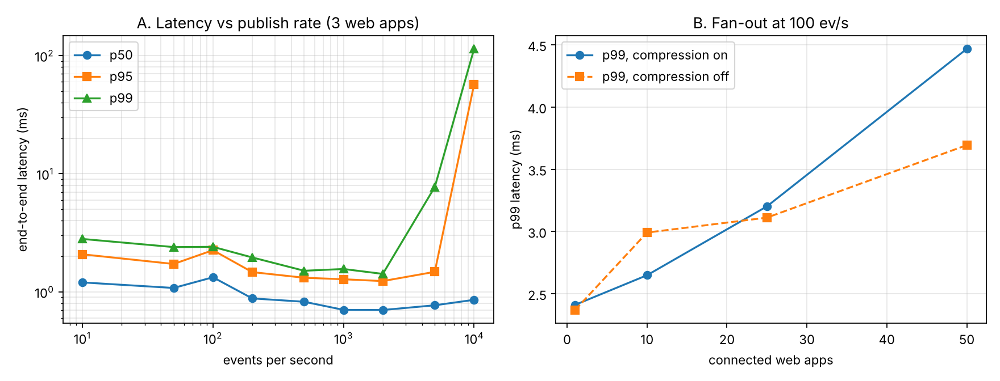

# Live event delivery: guarantees, latency and backpressure

Subsystem: Activity and Task Management (status updates to the web app). Code: `server/slate/api/events.py`. Tests: `tests/test_event_delivery.py`. Benchmark: `scripts/bench_events.py`, results in `docs/bench/`.

The backend pushes every status change (device state, agent steps, tasks, approvals) to the web app over one WebSocket, `/api/ws/events`. This document says what that stream promises, how the promise is kept when things go wrong, and what we measured.

## The delivery rule

A web app that reconnects with the last event id it saw gets **every event after it, in order, with no gaps and no repeats**. If that is impossible, it gets `system.resync` first and starts over from a fresh snapshot. It never misses an event without being told.

Three mechanisms keep this rule:

1. **Replay buffer.** The server keeps the last 500 events in memory. On reconnect, `?after=<id>` replays exactly the events after that id.
2. **Bounded per-client queue (100 events).** If a web app falls 100 events behind, its backlog is dropped and the server closes the socket with code 1013 ("try again later"). The app reconnects with its cursor and replays from the buffer. One slow app can never make the server hold unbounded memory or slow down the others.
3. **Send deadline (5 s).** If one send blocks for 5 s (the app stopped reading and the TCP buffers are full), the server gives up on that connection.

## Four bugs found and fixed

**Restart bug (silent loss).** Event ids used to be `evt_0000000001` and restarted from 1 when the server restarted. A web app reconnecting after a restart with `after=evt_0000000300` would match an id in the *new* buffer and be told nothing was missing. Reproduced: after a restart with 400 new events, the app got 100 and silently lost 300.
Fix: ids are now `evt_<boot>_<seq>`, where `boot` is random per server start. A cursor from another boot is always stale, so the app gets `system.resync`.

**Off-by-one (needless resync).** If the app's cursor was the event just before the oldest one in the buffer, the server forced a resync even though nothing was missing. Fix: a resync happens only when an event after the cursor has actually left the buffer. This makes the buffer sizing rule below exact.

**Skipped event after a resync (my own regression).** My first fix for the off-by-one found events by counting positions in the buffer. But `system.resync` takes a sequence number and is never buffered, so the numbers in the buffer can have holes, and counting positions then skipped one event with no resync. The randomized test found it on a later run. Fix: `since()` now compares sequence numbers, and the server remembers the newest number pushed out of the buffer, so "is anything missing?" is exact (`cursor < newest dropped`) whether or not the numbers have holes. The failing case is pinned as a fixed example in the test, and the test then passed 20,000 random cases.

**Cancellation leak (flaky disconnect).** The handler ran its sender and listener as bare asyncio tasks. Starlette cancels a handler through anyio, and when that cancel arrived at the wrong moment it escaped as a `CancelledError` instead of a clean close. It failed 13 of 50 runs on Python 3.12.15 and 22 of 50 on 3.12.2 (the Mac's version). Fix: the two sides run in an anyio task group, and the send deadline uses `anyio.fail_after`, so all cancellation goes through one system. After the fix: 0 of 200 runs failed on both versions.

The first two bugs were caught by tests that fail on the old code and pass on the new code. The randomized test (400 random mixes of publishing, slow reading, dropped connections and restarts, buffer sizes 2 to 20, queue sizes 1 to 10) found the restart bug by itself.

## Buffer sizing

A web app that is offline for `d` seconds while events arrive at `R` per second comes back `R × d` events behind. Replay works if and only if

    R × d ≤ buffer size (500)

Measured (experiment E): an app offline for 1 s every 2 s.

| R (ev/s) | R × d | Predicted | Resyncs measured | Silent gaps |
|---|---|---|---|---|
| 100 | 100 | replay | 0 | 0 |
| 250 | 250 | replay | 0 | 0 |
| 400 | 400 | replay | 0 | 0 |
| 600 | 600 | resync | 2 | 0 |
| 1000 | 1000 | resync | 2 | 0 |

The prediction was right in all 5 cases, and no case had a silent gap.

What this means for Slate: our real traffic is a few events per second, and at most about 20 ev/s while speech transcripts stream. At 20 ev/s the buffer covers `500 / 20 = 25 s` offline, which is longer than the web app's first 4 reconnect attempts (1 + 2 + 4 + 8 s).

## Latency measurements

Method: the real EventBus and route run under uvicorn in one process, and real WebSocket clients run in 4 other processes, all on 127.0.0.1. Latency is from when the event was **scheduled** to be published until a client parsed it. Measuring from the scheduled time means a stalled server event loop shows up as latency instead of hiding ("coordinated omission"). All runs: Linux, 2 CPUs, Python 3.13, uvicorn 0.52.4, websockets 17.1, 8 s per run. Rerun on the Mac for final numbers.

### A. Latency vs publish rate (3 web apps)

| Rate (ev/s) | p50 (ms) | p95 (ms) | p99 (ms) | Publisher lag p95 (ms) |
|---|---|---|---|---|
| 10 | 1.20 | 2.08 | 2.80 | 1.52 |
| 100 | 1.33 | 2.25 | 2.40 | 2.01 |
| 500 | 0.82 | 1.32 | 1.51 | 1.09 |
| 1000 | 0.70 | 1.28 | 1.56 | 1.08 |
| 2000 | 0.70 | 1.23 | 1.42 | 1.04 |
| 5000 | 0.77 | 1.48 | 7.72 | 1.17 |
| 10000 | 0.86 | 57.10 | 114.05 | 56.96 |

- Up to 2000 ev/s, p99 stays under 3 ms. That is 100 times our real load.
- The knee is between 5000 and 10000 ev/s. There the publisher itself is 57 ms late (p95), so the limit is the single Python event loop running out of CPU, not the delivery path.
- Publisher lag is most of the measured latency at every rate. Delivery itself (queue, JSON, WebSocket, client parse) adds about 0.5 ms.
- Latency is slightly *higher* at 10 ev/s than at 1000 ev/s. At low rates every event wakes sleeping processes, and that OS wake-up costs more than the work itself.

### B. Fan-out at 100 ev/s

| Web apps | p99, compression on (ms) | p99, compression off (ms) |
|---|---|---|
| 1 | 2.41 | 2.37 |
| 10 | 2.65 | 2.99 |
| 25 | 3.20 | 3.11 |
| 50 | 4.47 | 3.69 |

Per-message compression (on by default in browsers and uvicorn) compresses separately for every connection. It costs about 0.8 ms of p99 at 50 apps and is within noise below that. Slate has 1 or 2 web apps per device, so we keep the default.

### C. A slow web app (reads 20 ev/s) among 3 fast ones, 200 ev/s of 1 KB events

| | Fast apps p99 (ms) |
|---|---|
| Without the slow app | 1.63 |
| With the slow app | 1.81 |

The fast apps are unaffected. The slow app lost nothing (0 gaps, 0 duplicates), but **its view was 6.2 s old at p50 and 12.3 s at worst**, and it was never reset. That is a real limitation, explained below.

### D. A stalled web app (never reads), 500 ev/s of 4 KB events

| | Fast apps p99 (ms) | Resets | Dropped by send deadline |
|---|---|---|---|
| Without the stalled app | 1.67 | 0 | 0 |
| With the stalled app | 2.17 | 25 | 1 |

Timeline: the TCP buffers filled at about 3.7 s, sends started blocking, and the 5 s deadline dropped the connection at 8.7 s. Without the deadline, the handler would have stayed subscribed (and kept being reset) until keepalive killed the socket. The fast apps stayed under 2.2 ms p99 the whole time. The socket itself was torn down 40 s later by uvicorn's keepalive (20 s ping interval plus 20 s timeout). By then it held no events and no queue.

## Known limitation: lag hidden in TCP buffers

The 100-event queue bounds **server memory**, not **how far behind a web app is**. The operating system buffers several MB per connection (Linux auto-tunes up to about 4 MB each way), so a slow reader can fall seconds behind before the server's queue fills. Experiment C shows 12 s of lag with no reset.

Options, cheapest first:
1. **Web app staleness check.** Every event carries `ts`. The app can show "catching up" when `now - ts > 2 s`. Frontend only.
2. **Acks.** The app sends its last id every second; the server resets any app more than N events behind. This bounds lag exactly but changes the protocol in both directions.
3. **Conflation.** `device.status` is state, so only the latest one matters. A slow app could get just the newest status instead of every old one.

For now, the realistic slow case is a phone on weak Wi-Fi. The stream stays correct there, and option 1 is the suggested next step.

## Recommendations

- **Status update latency requirement.** The server path adds under 3 ms p99 at any load we expect. Whatever threshold the subsystem report sets should be chosen for Wi-Fi and the ESP32, not the server; the server uses about 1% of a 250 ms budget.
- **Fast reconnect on 1013.** The web app waits 1 s after any close. After a 1013 it could reconnect in about 100 ms, because its place is still in the buffer. That shrinks `d` and raises the safe rate.
- **Shorter keepalive.** `--ws-ping-interval 10 --ws-ping-timeout 5` on uvicorn would tear down dead sockets in 15 s instead of 40 s.
- **Monitoring.** `GET /api/events/stats` (local only) reports published events, resets, stalled drops, the deepest queue seen, listeners and buffer use.

## Verification

`tests/test_event_delivery.py`, 11 tests:
- restart with overlapping ids forces resync (fails on the old code)
- cursor just before the buffer loses nothing (fails on the old code)
- replay is correct when sequence numbers have holes
- malformed and foreign cursors force resync
- reset and queue depth counters
- randomized protocol test: never a silent gap or repeat (fails on the old code)
- a send that never returns is dropped at the deadline without waiting on a close frame
- WebSocket replay after reconnect, resync on a stale cursor, stats endpoint, 403 for other machines

`scripts/bench_events.py` checks its own results and fails if any client sees a silent gap or duplicate, if the stalled client is never dropped, or if any buffer sizing prediction is wrong. Full run: PASS.
