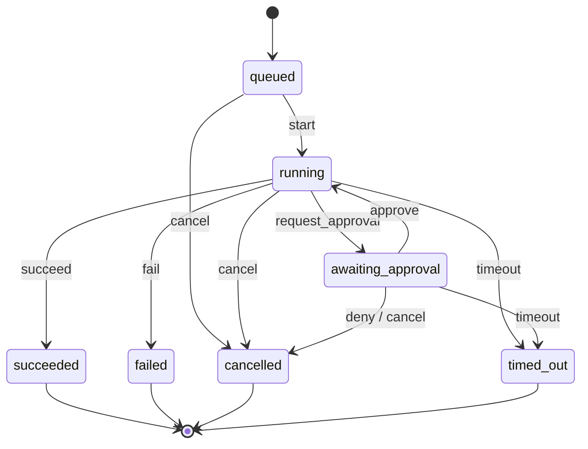

# Task state machine

Subsystem: Activity and Task Management. Code: `server/slate/tasks/`, API: `server/slate/api/tasks.py`, tests: `tests/test_tasks.py`, benchmark: `scripts/bench_tasks.py`.

Every request the agent works on (pay a bill, book an appointment) is a task. A task moves through a fixed set of states, and the server refuses any move that is not in the table below. Sensitive steps stop and wait for the user to approve them from the web app or the device.

## States

## Transition table

7 states and 8 events give 56 (state, event) pairs. 11 are allowed. The other 45 raise `InvalidTransition` and change nothing.

| From | Event | To |
|---|---|---|
| queued | start | running |
| queued | cancel | cancelled |
| running | request_approval | awaiting_approval |
| running | succeed | succeeded |
| running | fail | failed |
| running | cancel | cancelled |
| running | timeout | timed_out |
| awaiting_approval | approve | running |
| awaiting_approval | deny | cancelled |
| awaiting_approval | cancel | cancelled |
| awaiting_approval | timeout | timed_out |

succeeded, failed, cancelled and timed_out are terminal: no edge leaves them, so a finished task can never restart.

## Design decisions

**Atomic transitions.** Each change runs inside one SQLite `BEGIN IMMEDIATE` transaction. That takes the write lock before reading, so "read the state, check the table, write the new state, log the edge" happens as one step. Two writers can never both read the same old state.

**One decision per approval.** The web app, the device button and the timeout timer can all try to close the same approval at the same moment. The approval row can only leave `pending` once. The first one to commit wins and every other caller gets `409 approval_closed` with who won.

**Version check.** Every transition adds 1 to `tasks.version`. The web app can send the version it is showing. If the task changed since, the decision is refused (`409 stale_version`), so the user never approves something they did not see.

**Timeouts.** An approval stores its deadline in the database and arms an asyncio timer. If the user answers first, the timer is cancelled. If the timer and the user hit at the same instant, the rule above picks one.

**Restarts.** On startup `recover()` runs:
- tasks that were `running` fail with "server restarted mid-task", because their work is gone
- pending approvals past their deadline time out right away
- pending approvals still in time get a timer for the time they have left

**Retention.** The store keeps the newest `keep` finished tasks (default 100) and deletes older ones with their history. Active tasks are never deleted.

**Trade-off.** SQLite writes are synchronous and take about 1.4 ms, which blocks the event loop for that long. At our load (a few tasks per minute) this is fine. If it ever matters, writes can move to a worker thread without changing the design.

## API

All routes only accept requests from the local web app, the same rule as `/api/ws/events`.

| Route | Does |
|---|---|
| `GET /api/tasks?limit=50` | newest tasks first |
| `GET /api/tasks/{id}` | task, full transition history, approvals |
| `POST /api/approvals/{id}` | body `{"decision": "approve" or "deny", "source": "web" or "device", "expected_version": 3}` |
| `POST /api/tasks/{id}/cancel` | cancel an active task |

Live events on `/api/ws/events`: `task.updated`, `approval.requested`, `approval.resolved`.

`SLATE_DEMO_TASKS=1 make server` runs a sample bill payment that waits 30 s for approval.

## Verification

`tests/test_tasks.py`, 27 tests:
- all 56 (state, event) pairs checked against the table
- every state reachable from queued, every active state can reach a terminal state, terminal states have no exits
- 150 random event sequences (Hypothesis): the stored state always matches the pure table, version and history length always equal the number of accepted events, and rejected events leave no trace
- 12 threads closing one approval at once, 25 trials: exactly one winner each time
- cancel racing approve: the result always matches one of the two serial orders
- timeout, timer cancelled by an answer, restart with time left, restart after the deadline
- API: 200, 404, 409 (closed and stale), 422, 403 for non-local callers

`scripts/bench_tasks.py` (Linux, Python 3.13; run again on the Mac for final numbers):

| Measure | Result |
|---|---|
| Transition write latency (600 writes) | p50 1.3 ms, p95 1.8 ms, p99 2.5 ms |
| Race, 8 callers, 200 trials | 200/200 with exactly one winner |
| Timeout firing delay (100 approvals) | p50 0.6 ms, p95 1–2 ms, never early |
| Retention, 1000 finished tasks, keep 100 | 100 kept |
